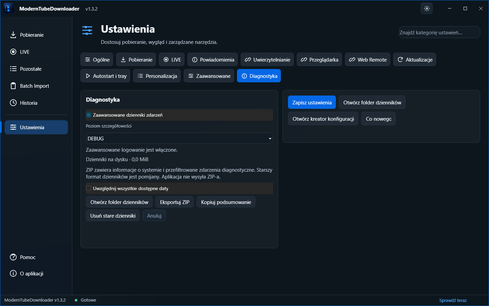
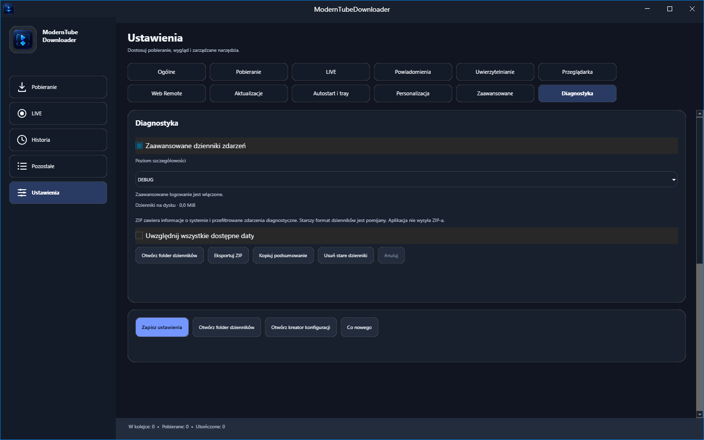

# ModernTubeDownloader 1.3.2 — zaawansowana diagnostyka i kwalifikacja hotfixa

Stan na 25 listopada 2026. Zmiany należą do istniejącego hotfixa z bazy `v1.3.1` i PR #30. Aplikacja pozostaje na dotychczasowym pinie ModernFormsNext `7bf58d06d795d7298c86d9bf9471bbfb46852bab`. Raport o pierwotnych incydentach jest osobnym dokumentem. [Raport produkcyjny](PRODUCTION-INCIDENT-1.3.2-REPORT.md) · [PR #30](https://github.com/ProGraMajster/ModernTubeDownloader/pull/30)

## Kontekst incydentu

W oficjalnej 1.3.1 na kontrolowanym woluminie pierwszy `DriveUnavailable` prawidłowo opisywał stan Windows. Po przywróceniu litery Organizator nadal miał pusty automatyczny cel. Następna analiza odrzucała także ten stan. Przy innym przebiegu błąd pozostawiał na ekranie wiersze wcześniejszego planu. Zgłoszony przez użytkownika późniejszy przebieg pozostaje nieudokumentowany. Nowe zdarzenia pozwolą sprawdzić, czy kliknięcie dotarło do widoku, czy usługa uruchomiła skan i czy UI pobrał wynik. [Szczegóły reprodukcji i poprzedniej kwalifikacji](PRODUCTION-INCIDENT-1.3.2-REPORT.md#reprodukcja-na-opublikowanej-131)

## Audyt i architektura

Przed zmianą `FileAppLogger` używał jednej nieograniczonej `BlockingCollection` i `StreamWriter.AutoFlush` przy każdym wpisie. Nazwa dzienna była ustalana jednorazowo w konstruktorze. Nie było progu rozmiaru, retencji, dynamicznych poziomów ani wskaźnika niedostępnego zapisu. Nieudany zapis kończył konsumenta, więc producenci mogli dalej gromadzić dane. Anonimizator usuwał rozpoznane URI i sekrety, lecz dowolne komunikaty narzędzi, wyjątki, nazwy plików lub tytuły nadal mogły trafić do logu. Instalator miał własny prosty dziennik etapów. NativeHost pisał binarnie do przeglądarki i zapisywał ograniczony, szyfrowany plik stanu dla rozpoznanego powiązania.

Rozbudowany `IAppLogger` ma jeden dziennik aplikacji w formacie JSON Lines. Domyślne poziomy obejmują INFO–FATAL. Ustawienie DEBUG włącza liczniki i etapy, a TRACE dodaje limitowane czasowo próbki postępu. Zapis ustawień używa istniejącej trwałej ścieżki `SettingsService`. Zdarzenie z ustawień zmienia próg zapisu działającego procesu. Włączenie diagnostyki kolejkuje snapshot poza wątkiem UI. Start aplikacji zapisuje ten sam rodzaj snapshotu po utworzeniu formularza oraz pomiar inicjalizacji usług. Dziesięciosekundowy sampler działa tylko po włączeniu zaawansowanego poziomu. Raportuje working set, private bytes, stertę zarządzaną, wątki, różnicę czasu CPU, kolekcje GC, liczebność kolejek i aktywność procesu narzędziowego lub Organizatora. Laboratorium profilowania używające wcześniejszej flagi środowiskowej pozostaje niezależnym narzędziem deweloperskim.

Kolejka ma 1 024 miejsca na normalne wpisy i 128 osobnych miejsc na WARN–FATAL. Konsument opróżnia partie i preferuje wpisy priorytetowe. Po przepełnieniu podaje zbiorczą liczbę pominiętych wpisów w obu klasach. Ograniczona pamięć może oznaczać utratę również ostrzeżeń, jeżeli ich bufor się wypełni. Krytyczny wyjątek może wywołać osobny, synchroniczny zapis zdarzenia FATAL do tego samego formatu bez oczekiwania na główną kolejkę. Awaria zapisu jest odnotowana w stanie loggera. Próba wznowienia odbywa się z odstępem, a odmowa, zapełniony dysk i blokada pliku nie są ponownie logowane przez ten sam logger. Zamykanie daje kolejce ograniczony czas na zapis.

Segmenty aplikacji rotują przy zmianie dnia UTC lub przed przekroczeniem 25 MiB. Limit zapisanych logów aplikacji to 250 MiB z rezerwą na nowy segment. Retencja 14 dni i usuwanie według limitu dotyczą rozpoznanych plików w katalogu logów. Zablokowane pliki mogą pozostać do późniejszej próby. Polecenie ręczne usuwa rozpoznane dzienniki z poprzednich dni po potwierdzeniu. Zachowuje dzisiejsze, inne nazwy, dowiązania oraz pliki nadal blokowane przez zapis. Osobny dziennik procesu instalatora jest ograniczony do około 64 KiB na żądanie. Eksport rozpatruje do 64 jego najnowszych dzienników w wybranym okresie. Pliki transakcji i odzyskiwania instalatora nie są usuwane przez retencję aplikacji.

### Schemat i katalog zdarzeń

Każdy rekord zawiera czas UTC, poziom, numeryczny EventId, nazwę `Moduł.Etap.Wynik`, wersję aplikacji, ID sesji, PID i identyfikator zarządzanego wątku. Opcjonalne są `operationId`, `parentOperationId`, czas, klasa wyjątku (z zamkniętego zbioru), HRESULT, `cancellationReason` (obecnie kod `CancellationRequested`) i liczniki. Zdarzenia można połączyć po identyfikatorach i uporządkować według czasu, ponieważ priorytet może zmienić kolejność zapisu. Dla starszych wywołań INFO/WARN/ERROR opis lokalny ogranicza się do klasyfikacji i miejsca wywołania w kodzie. Dowolny tekst przekazywany przez starsze wywołanie nie jest zapisywany.

| Moduł | Instrumentacja |
| --- | --- |
| Aplikacja, ustawienia, wygląd, lokalizacja i migracja | `Application.Startup`, `Application.Snapshot`, `Application.Shutdown`, `Settings.Load`, `Settings.Save`, `Migration.Load`, FATAL z klasą błędu, HRESULT i dostępnymi licznikami UI. Snapshot zawiera konfigurację, wersje, commit, ustawienia wyglądu i języka, profil migracji oraz bezpieczne role woluminów. Starsze wywołania zachowują kategorię i lokalne miejsce w kodzie. |
| Organizer | Osobne otwarcie/zamknięcie, żądanie analizy i odrzucenie, oczekiwanie na bramkę, walidacja i typ woluminu, format/rozmiar importu, skan, liczba katalogów i plików, odczyt Historii i kolejki, dopasowania, brakujące i błędne pozycje, duplikaty, konflikty, metadane i czas etapu. `Plan` to zakończenie usługi, `Dispatcher` to kolejka i wykonany callback, a `Preview` to końcowy stan widoku. `Move`, `Undo` i `Recover` mają oddzielne wyniki. TRACE postępu analizy jest ograniczony do próbki co około dwie sekundy. |
| Aktualizacja, sieć, instalator | `Initialize`, `Check`, `Download`, HTTP dla ZIP i sumy, `Checksum`, `Extract`, `WaitForParent`, `Journal`, `Replace`, `Rollback`, `Commit`, `Restart` i `Result`. Wspólny GUID wynika też z katalogu runnera. Awaria restartu jest odrębna od udanej instalacji. Liczniki i bity obecności plików wspierają rozpoznanie mieszanego zestawu zależności. |
| Batch | `Import`, `Match`, `Recover`, liczba sesji i wierszy, schemat oraz rozróżnienie brakujących metadanych (1), obcego schematu (2), niezgodnego ID (3), nieznanej fazy (4), braku wierszy (5), błędu JSON (6), odmowy dostępu (7) i błędu I/O (8). Format starych danych i zasada zachowania nieczytelnej sesji są utrzymane. |
| Pobieranie, kolejka, historia i LIVE | Bezpieczne identyfikatory operacji, czas próby, status, kategoria błędu, kod HTTP/exit, parametry jakości/kontenera jako liczby, zakończenie analizy metadanych, czas trwania odcinka i agregaty rekordów. `History.Load`, `History.Save`, `History.Match` i `History.Controls` mierzą ładowanie, zapis, filtrowanie i przygotowanie strony. `Queue.Load`, `Queue.Save` i `Queue.Controls` mierzą ładowanie, zapis i przygotowanie strony w obu powłokach. Liczniki podają liczbę wierszy i wielkość kolekcji. LIVE korzysta też z klasyfikacji dotychczasowych miejsc wywołania. |
| Narzędzia, pamięć podręczna i pliki | `Tools.Run` od żądania do kodu wyjścia/anulowania, narzędzie jako kod (1 yt-dlp, 2 FFmpeg, 3 FFprobe, 4 Deno, 0 inne), liczba wierszy strumieni, czas oraz flagi użycia pliku cookies i sponsor mark. Klasyfikacja przechwyconego błędu działa w pamięci. Pełne argumenty, stdout i stderr nie są utrwalane. Błędy cache/persistencji korzystają z pola typu i HRESULT. |
| Powiadomienia, Web Remote, ModernFormsNext | `WebRemote.Startup`, `WebRemote.Shutdown`, `WebRemote.Validate` i `WebRemote.Import` obejmują uruchomienie, zatrzymanie, odrzucenie uwierzytelnienia i liczbę dodanych zadań bez adresów klientów. `Notifications.Initialize` opisuje stan uruchomienia dostawcy powiadomień. Wersja i commit ModernFormsNext są w snapshocie. Starsze wpisy o renderowaniu i awariach pozostają klasyfikowane według miejsca wywołania. |
| NativeHost | Binarny protokół i szyfrowany plik kontrolny zachowane. Snapshot pokazuje wyłącznie obecność tego pliku. Dane przeglądarki, origin, zawartość pliku i identyfikatory klienta nie wchodzą do ZIP-a. |
| Logger i wydajność | `Logging.Run.Skipped`, `Retention`, `Export`, `Performance.Sample`. Mierzone są czas CPU, pamięć i liczniki. Szczegółowy niezależny monitor responsywności pozostaje zadaniem 1.4.0. |

Wybrane pola z natywnej analizy 3 500 linków. Identyfikator operacji łączy usługę, kolejkę UI i widok.

```jsonl
{"logLevel":"Info","eventName":"Organizer.Preview.Requested","operationId":"f4edf5ce-0b4f-47a8-b972-b835272aa49e","counts":{"items":1,"missing":0,"context":1}}
{"logLevel":"Info","eventName":"Organizer.Plan.Completed","operationId":"f4edf5ce-0b4f-47a8-b972-b835272aa49e","durationMs":879,"counts":{"waitMs":0}}
{"logLevel":"Info","eventName":"Organizer.Dispatcher.Completed","operationId":"f4edf5ce-0b4f-47a8-b972-b835272aa49e","durationMs":22,"counts":{"items":3500}}
{"logLevel":"Info","eventName":"Organizer.Preview.Completed","operationId":"f4edf5ce-0b4f-47a8-b972-b835272aa49e","durationMs":931,"counts":{"items":3500}}
```

Wartości sprzętowe pochodzą z bezpiecznych zapytań Windows. Obejmują rodzinę systemu i build, architekturę, język i kulturę, podniesienie procesu, modele CPU/GPU, rdzenie, RAM, liczbę i rozdzielczość monitorów, DPI oraz dostępność, system plików i wolne miejsce dla ról woluminów. Brak odpowiedzi oznacza pole niedostępne lub pominięte. Aplikacja nie próbuje sprawdzać wolnego miejsca w mapowanych udziałach sieciowych. Stan wymaganych assembly pokazuje oczekiwane nazwy i wersje bez ścieżek i bez ładowania instalatora do GUI.

## Ustawienia i ZIP

W obu powłokach wybierz **Ustawienia → Diagnostyka**. Pod przełącznikiem są poziom, aktualny stan, rozmiar, zakres dat, otwarcie folderu, eksport, kopia krótkiego podsumowania i potwierdzane czyszczenie. Domyślny eksport korzysta z ostatnich 24 godzin. Pole „wszystkie dostępne daty” obejmuje okres retencji. Przycisk anulowania wycofuje pracę w tle. ZIP jest zapisywany do wybranego katalogu przez unikalny plik tymczasowy. Po ukończeniu plik jest publikowany bez nadpisania istniejącego ZIP-a. Anulowanie sprząta plik tymczasowy.

```text
MTD-Diagnostics-YYYYMMDD-HHMMSS.zip
  diagnostic-summary.txt
  system-info.json
  application-info.json
  assembly-versions.json
  settings-redacted.json
  storage-summary.json
  logs/events-*.jsonl
  updater/events-*.jsonl   (jeśli dostępne zgodne wpisy)
```

Próbki wydajności są częścią strumienia zdarzeń i są filtrowalne po module `Performance`. Eksporter czyta ustalony początkowy zakres aktywnie zapisywanego pliku i używa tylko pełnych rekordów. Ponownie buduje tekstowe pola zdarzeń według znanego schematu, wyrzuca nieznane wartości i dołącza oddzielnie aktualny snapshot. Stare logi tekstowe, nieobsługiwane formaty, treść wyjątku, ścieżki i nazwy list, ID materiałów, pełne URL, nagłówki, dane rejestru przeglądarki, bazy, cookies i dane pobrań są poza pakietem. Interfejs pokazuje liczbę plików włączonych i pominiętych. ZIP trafia wyłącznie do wybranej lokalizacji. Na komputerze źródłowym stary format można uzupełnić istniejącym kolektorem tylko do odczytu. [Kolektor incydentu](scripts/Get-ProductionIncident132Evidence.ps1)

## Przegląd PR #27 i issue #23

Sprawdziłem `4fefe9e`, testy autora, wyniki CI oraz kod transakcji i odpowiedzi GUI. PR #27 normalizuje zakończenie ścieżki instalacji, oddziela błąd pierwotny od błędów rollbacku, sprawdza bajty odzyskanych plików, chroni nieukończony dziennik i publikuje wynik przez atomową podmianę. Rozróżnia `Restored`, `Partial` i `Unknown` oraz dopuszcza automatyczny restart dopiero po zatwierdzonej instalacji. W wersji hotfixa sprzed #27 samo pole `Completed=true` oznacza domkniętą transakcję lub domkniętą próbę przywrócenia. GUI wciąż ma ogólny status niepowodzenia na podstawie `success`. Nowe zdarzenia diagnostyczne rozdzielają te etapy tylko w logu.

PR #27 zachowuje `File.Move(..., overwrite: true)` przy zastąpieniu dziennika. Próby z blokadą potwierdzają zachowanie przy awarii, ale nie identyfikują pierwotnego źródła sporadycznej odmowy na komputerach testowych i produkcyjnych. Poprawka pracuje na innej bazie i dotyka plików `Program.cs`, kontraktu wyniku, transakcji i aplikacyjnego odczytu. Dotychczasowa kwalifikacja #27 dotyczy własnego commitu i bazy. Włączenie #27 do 1.3.2 wymaga ponownej kwalifikacji rollbacku i migracji na połączonym wariancie. Aktualny kandydat używa kodu transakcji z hotfixa i dodaje do niego obserwowalne etapy. Stary instalator w przejściu z 1.3.1 używa nadal swojego kodu. Podczas kwalifikacji tego ZIP-a stary instalator 1.3.1 ponownie zgłosił `UnauthorizedAccessException` przy dzienniku. Nie uruchomił nowego GUI. Po awarii plik EXE nadal miał wersję 1.3.1, znacznik profilu zachował treść, a dziennik miał `Completed=true`. To jest bezpośredni przykład zakończonej obsługi błędu przy nieudanej instalacji. Pierwotne źródło odmowy pozostaje nieustalone. Do pierwszej weryfikacji u zgłaszającego służy uruchomienie ZIP-a z nowego folderu. [Issue #23](https://github.com/ProGraMajster/ModernTubeDownloader/issues/23) · [PR #27](https://github.com/ProGraMajster/ModernTubeDownloader/pull/27)

## Dwie wcześniejsze paczki 1.3.2

Stare ZIP-y miały po 815 plików. 804 wpisy są identyczne. Użyłem `PEReader` do porównania wszystkich 11 odmiennych DLL. W każdej parze zgadzają się bajty IL wszystkich metod w kolejności metadanych. Wszystkie 11 różni się zapisaną ścieżką PDB, identyfikatorem CodeView i MVID. Lokalne kompilacje w różnych checkoutach zakodowały różne ścieżki wejściowe i odpowiadające im dane debugowania w PE. To wystarcza do różnicy hashy mimo zgodnego IL. Porównanie nie oznacza identyczności całego PE. Kandydat opisany w sekcji kwalifikacji ma własną sumę. Wcześniejsze ZIP-y zachowują pierwotne sumy.

## Kwalifikacja końcowego kandydata

Źródła aplikacji i testów mają commit `03c23b4bfc36008434f6dbad41cf805c694c0f40`. Poniższa kwalifikacja używa tego commitu i czystego przypiętego checkoutu ModernFormsNext. Natywne próby dotyczą lokalnego Windows 11 26300, polskiego interfejsu, konta bez podniesienia i syntetycznych profili. Do analizy użyto katalogów testowych na D: i kontrolowanego mapowania Q:.

| Zestaw | Wynik |
| --- | ---: |
| Pełne .NET Debug | 1 651/1 651 |
| Pełne .NET Release | 1 651/1 651 |
| JavaScript, rozszerzenie i Web Remote | 93/93 |

Build Debug i Release zakończył się bez ostrzeżeń. Nowe testy pokrywają przełączanie poziomu, odczyt ustawienia, zapis współbieżny, przeciążenie, retencję, rotację, niedostępny zapis, walidację i anulowanie eksportu, korelację wyniku Organizatora oraz widok ustawień w obu powłokach. Błędy braku miejsca, odmowy dostępu i blokady są wstrzykiwane jako HRESULT. Test nie zapełnia rzeczywistego woluminu. Testy zasobów sprawdzają kompletność 16 katalogów.

### Interfejs i prywatność

W Modern Dashboard i Classic przeszła natywna próba startu z wyłączoną diagnostyką, włączenia DEBUG, zapisu ZIP-a w wybranej lokalizacji i odczytu ustawienia po restarcie. W obu archiwach było siedem wpisów. Każde dołączyło jeden dziennik strukturalny i pominęło jeden syntetyczny dziennik tekstowy z danymi kontrolnymi. Każdy proces zapisał próbkę wydajności do własnego dziennika. W Modern Dashboard anulowałem eksport podczas czytania dużego dziennika. Interfejs pokazał anulowanie. Katalog wyjściowy pozostał bez pliku końcowego i tymczasowego.





### Organizator i porównanie wydajności

Na kandydacie wracał plan 10/10 po przywróceniu mapowania w tym samym oknie, również po drugiej utracie woluminu. Analizę można było wykonać po ponownym otwarciu Organizatora i po ponownym uruchomieniu aplikacji. Niedostępne źródło i brak folderu kończyły operację czytelną informacją oraz ponownym uaktywnieniem przycisku. Przypadek celu zajętego przez plik dał odpowiedni komunikat podczas próby TRACE. W dodatkowej próbie z zapisem pól przez UI Automation raz pojawił się `PathType`, a osobne sprawdzenie wykryło niestabilną wartość pola po `SetValue`. Przyczyna zachowania automatyzacji pozostaje nieustalona. Pomiar wydajności używa wstępnie ustawionych katalogów, dzięki czemu test rozmiarów nie zależy od programowego wpisywania ścieżek.

Każdy tryb obejmował pięć analiz w tej samej kolejności na dwóch równoważnych bibliotekach fizycznego NTFS D:. Każda biblioteka zawierała 3 500 syntetycznych plików multimedialnych i 3 500 metadanych. Wynik 10 000 dotyczy liczby pozycji planu, obejmującej również brakujące materiały. UI pokazał gotowy plan dla wszystkich rozmiarów i wyświetlił do 40 pozycji na stronie. Każde z pięciu żądań w danym trybie miało jeden końcowy wynik podglądu i powiązane zakończenie usługi oraz publikacji w Dispatcherze. Suma kontrolna pliku kontrolnego pozostała bez zmian. Folder docelowy nie powstał.

W tabeli kolejność wartości to standard → TRACE. Czas do wyniku obejmuje reakcję na kliknięcie, oczekiwanie kontrolera testowego i prezentację wyniku. CPU jest sumą czasu wątków procesu. Working set mierzy szczytowy przyrost widoczny w próbkach kontrolera. Ostatnia kolumna mierzy najwolniejszy odczyt dwóch kontrolek UI Automation w danym przebiegu.

| Linki | Do wyniku, ms | CPU, ms | Przyrost working set, MiB | Odczyt UIA, ms |
| ---: | ---: | ---: | ---: | ---: |
| 10 | 651 → 484 | 781 → 547 | 15,11 → 14,18 | 16 → 16 |
| 100 | 553 → 499 | 641 → 703 | 3,42 → 7,01 | 23 → 20 |
| 1000 | 605 → 616 | 828 → 891 | 8,68 → 10,68 | 31 → 24 |
| 3500 | 1116 → 1028 | 1453 → 1281 | 7,3 → 2,41 | 28 → 32 |
| 10000 | 998 → 1058 | 1281 → 1250 | 16,57 → 16,88 | 20 → 21 |

W krótkiej obserwacji bezczynności standard zużył 31 ms CPU w około 22 s, a TRACE 78 ms w około 22 s. Working set zmalał odpowiednio o 4,67 i 4,94 MiB. Sesja TRACE zawierała 104 zdarzenia DEBUG lub TRACE, w tym pięć próbek wydajności. Sesja standardowa nie zawierała zdarzeń tych poziomów. Największy scenariusz trwał około 60 ms dłużej przy TRACE, a krótsze pomiary zmieniały się w obu kierunkach. To po jednym przebiegu na rozmiar. Wynik obejmuje różnice cache i planowania procesów. Odczyt UI Automation nie mierzy wszystkich opóźnień interfejsu.

### Instalator i NativeHost z pakietu

Przeszło sześć natywnych prób plików wykonywalnych z tego ZIP-a. Obejmują NativeHost bez argumentów, oczekiwanie instalatora na rodzica, kontrolowaną blokadę DLL z przywróceniem bajtów, odrzucenie błędnej sumy, brak zgody rodzica na instalację startową i wariant z prawidłową zgodą. Niezależny dziennik instalatora zawierał oczekiwane wpisy dla oczekiwania i rollbacku. Identyfikator operacji odpowiadał żądaniu. Testy przeglądarki weryfikują kontrakt, a pełnej rejestracji na profilu zgłaszającego nadal trzeba użyć na jego systemie.

### Próba aktualizacji istniejącego profilu

Na syntetycznym profilu przejścia 1.2.1 → 1.3.0 → 1.3.1 zakończyły się restartem i uruchomieniem nowej wersji. Przejście 1.3.1 → 1.3.2 zakończyło się odmową obsługi dziennika przez instalator 1.3.1 w dwóch próbach. Po drugiej uruchomiłem dokładnie tę samą paczkę 1.3.2 z osobnego katalogu, korzystając z tego samego profilu. Pierwsze uruchomienie i restart zakończyły się prawidłowym sprawdzeniem aktualizacji oraz zapisem ustawienia automatycznego sprawdzania. Suma kontrolna pliku wykonywalnego w starym katalogu i suma kontrolna znacznika istniejącego profilu nie zmieniły się podczas próby z osobnego katalogu.

**Paczka jest gotowa do testu u zgłaszającego z nowego folderu.** Publikacja pozostaje wstrzymana do sprawdzenia komputera źródłowego oraz rozstrzygnięcia ryzyka automatycznego przejścia z 1.3.1. [Issue #23](https://github.com/ProGraMajster/ModernTubeDownloader/issues/23)

### Identyfikacja paczki

- Plik `ModernTubeDownloader-1.3.2-win-x64.zip`, 145 037 699 bajtów i 815 wpisów.
- SHA-256 `834849d87c625339b6dae2cc336b24cb9b296de6fa6054176ff131a4a77780b9`.
- Metadane wypakowanej aplikacji potwierdzają wersję 1.3.2 oraz dokładny commit źródeł i pin frameworka wskazane powyżej.
- Manifesty GUI, NativeHost i instalatora wskazują `win-x64` i własne środowisko .NET 10.0.15. Manifest GUI nie ma zależności od DLL instalatora. Updater działa z własnego podkatalogu.
- Kontrola archiwum potwierdziła brak plików profilu, danych użytkowników, narzędzi testowych i pomocniczego DLL aktualizatora w katalogu GUI.

## Instrukcja dla zgłaszającego

1. Przy zamkniętej starej aplikacji zbierz informacje z folderu 1.3.1 poleceniem opisanym w raporcie produkcyjnym. Wartości pól Organizatora podaj tylko lokalnie kolektorowi. Zachowaj JSON po przejrzeniu.
2. Wykonaj kopię istniejącego profilu `%LOCALAPPDATA%\ModernTubeDownloader` lub katalogu ustawionego przez `MODERNTUBEDOWNLOADER_DATA_ROOT`. Poczekaj na zamknięcie aktualizatora. Zachowaj folder starej aplikacji i wszystkie pobrania.
3. Porównaj SHA-256 pakietu z sumą w raporcie i wypakuj cały ZIP do nowego zapisywalnego folderu. Uruchom jego `ModernTubeDownloader.exe` z tym samym profilem.
4. Otwórz **Ustawienia → Diagnostyka**, włącz **Zaawansowane dzienniki zdarzeń** i wybierz DEBUG. TRACE można włączyć przy powtarzającym się długim skanowaniu.
5. W **Aktualizacjach** wykonaj ręczne sprawdzenie i zanotuj widoczny wynik. W Organizatorze ustaw źródło i cel, następnie wybierz **Analizuj · bez przenoszenia**. Pierwszą próbę zakończ na podglądzie. Zanotuj czas próby i status.
6. W Diagnostyce wybierz **Eksportuj ZIP** i katalog zapisu. Otwórz podsumowanie ZIP-a przed udostępnieniem. Przekaż ZIP i wynik kolektora uzgodnionym kanałem wsparcia. Oryginalne dzienniki i dane sesji zachowaj lokalnie.

## Ograniczenia

- Lokalny profil QA jest syntetyczny. Oba interfejsy na buildzie 22631 i zachowanie woluminu u zgłaszającego wymagają weryfikacji u źródła. Test mapowania DOS pozwala powtórzyć niedostępność bez ingerencji w tablicę partycji. Nie odtwarza zachowania sterownika odłączanego urządzenia.
- Moduły wyglądu, lokalizacji i integracji z frameworkiem korzystają ze snapshotu i klasyfikacji istniejących wywołań. NativeHost ma nadal wyłącznie zabezpieczony plik kontrolny i stan obecności w snapshocie. Zachowanie rzeczywistego rozszerzenia przeglądarki wymaga odrębnej próby z rejestracją i uwierzytelnieniem.
- Numer HRESULT i ograniczone słowniki kodów wskazują klasę problemu. Szczegóły niestandardowego błędu narzędzia wymagają samodzielnej lokalnej analizy. Gdy system blokuje zapis, nawet wpis krytyczny może się nie utrwalić. Stan i liczniki pominięć są dostępne na tyle, na ile system dopuszcza późniejszy zapis.
- Szczegóły uprawnień i sprzętu zależą od zapytań Windows. Odczyt aktywnego dziennika eksportuje dostępne pełne wiersze. Część zdarzeń powstających w trakcie eksportu może wymagać następnej paczki.
- Ocena zgodności pakietu dotyczy jednej lokalnej sumy. Uzgodnienie z użytkownikiem i decyzja o publikacji pozostają otwarte.

## Dalsza praca

[Issue #31](https://github.com/ProGraMajster/ModernTubeDownloader/issues/31) śledzi tę zmianę. [Issue #32](https://github.com/ProGraMajster/ModernTubeDownloader/issues/32) obejmuje przeglądarkę logów, oś wydajności i niezależny pomiar responsywności dla 1.4.0, uzupełniając działania naprawcze z [issue #16](https://github.com/ProGraMajster/ModernTubeDownloader/issues/16). Odzyskiwanie danych Batch pozostaje w [#28](https://github.com/ProGraMajster/ModernTubeDownloader/issues/28). Przeniesienie na 1.4.0 powinno zachować wspólny kontrakt identyfikatora aktualizacji i nowe klucze lokalizacji oraz świadomie wykonać integrację z transakcją #27. Gałęzie 1.4.0 nie brały udziału w tym hotfixie.
